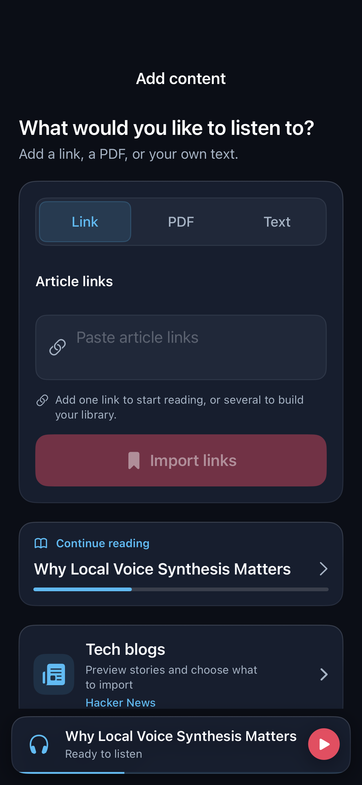
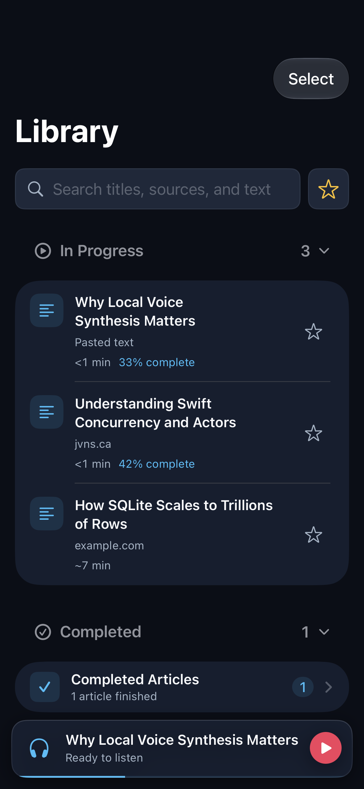
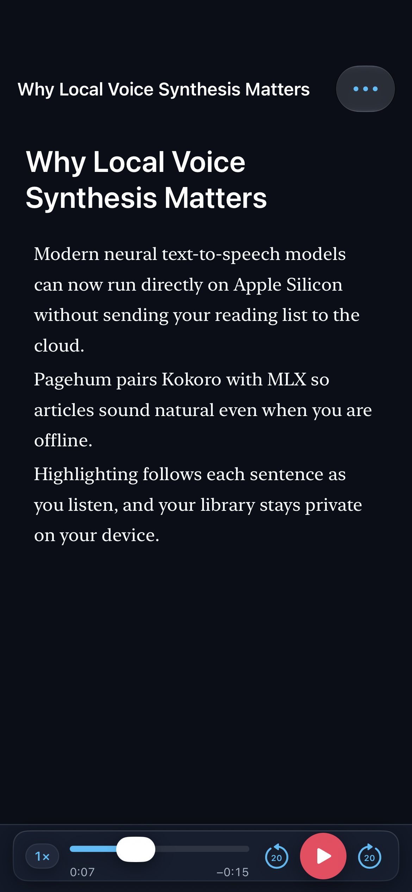

<div align="center">

# Pagehum

**Your reading list, read aloud.**

A native reader for Mac and iPhone, with local speech generation and a Mac command line.

[](#build-the-app)
[](#how-it-works)
[](LICENSE)

[Download CLI](https://github.com/Mieraidihaimu/pagehum/releases/tag/v0.1.0) · [Get started](#get-started) · [CLI guide](docs/CLI.md) · [Contribute](CONTRIBUTING.md)

</div>

Turn articles, PDFs, and pasted text into a listening library. Follow along while Pagehum reads, queue up your next article, or export narration from the terminal as M4A or WAV.

Speech is generated on your device using **Kokoro and Apple's MLX framework**. No speech API key or cloud TTS service is required. Web imports and tech blog discovery use the network; downloaded text and model assets can be used for local synthesis.

[Listen to a short Pagehum voice sample](https://github.com/Mieraidihaimu/pagehum/releases/download/v0.1.0/pagehum-sample.m4a).

<p align="center">
  
  
  
</p>

## What you can do

- **Listen to your reading list.** Import a web article, PDF, or pasted text into the app.
- **Read along.** Use the reader, playback controls, and text highlighting.
- **Keep a library and queue.** Search saved content and choose what plays next.
- **Back up your library.** Export and import saved posts, reading progress, favorites, and listening history from Settings → Library Backup. Audio and voice models are excluded.
- **Discover tech blogs.** Choose Hacker News, Lobsters, or direct feeds from GitHub Engineering, Cloudflare Engineering, Julia Evans, and Martin Fowler. Preview articles before saving them or import several in one tap.
- **Export audio from your Mac.** Feed the CLI text, a file, stdin, or an article URL; get M4A or WAV.
- **Choose English voices.** The CLI supports American and British English voice styles and lists them with `pagehum voices`.

## Get started

The first public version is an **early prerelease**. [Download the Apple Silicon CLI](https://github.com/Mieraidihaimu/pagehum/releases/tag/v0.1.0), or build the app and CLI from source below. The CLI archive includes the model assets and is not notarized. There is no signed app installer or App Store release yet.

After extracting the CLI archive, open its `pagehum` directory in Terminal and run `./pagehum --help`. Keep the whole directory together. If macOS blocks this unsigned prerelease, build from source. A SHA-256 checksum file accompanies the download.

| Component | Requirements |
| --- | --- |
| macOS app and CLI | Apple Silicon, macOS 15.6+, Xcode 26.1+ with the Metal toolchain |
| iOS app | Physical device with MLX support; app target is iOS 18.6+ |
| Bundled iOS share extension | iOS 18.6+, matching the app |

MLX speech generation does not run in the iOS Simulator; there the app falls back to Apple's built-in voices.

### Build the app

1. Open Xcode once to finish setup. Install the Metal toolchain if needed.

   ```sh
   xcodebuild -downloadComponent MetalToolchain
   ```

2. Clone the source and run the model setup script from the repository root. A standard Git clone contains the source code. The Kokoro model and voice files are downloaded separately.

   ```sh
   git clone https://github.com/Mieraidihaimu/pagehum.git
   cd pagehum
   ./scripts/download-models.sh
   ```

   The script downloads about **342 MB** from a pinned upstream revision, verifies SHA-256 checksums, and saves `kokoro-v1_0.safetensors` and `voices.npz` in `Resources/`. Debug app builds and the CLI package use those files. If Xcode reports a missing model resource, rerun the script from the checkout you are building. It reuses files that pass verification.

3. Open the project in Xcode.

   ```sh
   open Pagehum.xcodeproj
   ```

4. Select **Pagehum-macOS** and **My Mac**, or **Pagehum-iOS** and an iPhone simulator or connected iPhone. Press **⌘R** to build and run. If Xcode asks for signing, select your team under **Signing & Capabilities**. For a physical iPhone, set your own bundle identifiers for the app and share extension and configure the same app group in both targets and their Swift code. See [compatibility notes for development installs](CONTRIBUTING.md#compatibility).

To build the app without downloading model files first, choose **Release** under **Product → Scheme → Edit Scheme → Run → Info**. Release builds use system voices until you select **Download natural voices** in Pagehum Settings on a supported device.

### Verify the iPhone release

```sh
./scripts/verify-ios.sh
```

This runs the iPhone simulator regression suite, builds an unsigned device Release archive,
and checks its packaging. Debug voice weights are excluded for this test run, so no model
asset download is needed. Install an iPhone simulator runtime and the Metal toolchain in Xcode.
The same checks run in GitHub Actions. See [iPhone release preparation](docs/IOS_RELEASE.md)
for physical-device checks and TestFlight signing.

Sharing a web link saves it for import when you next open Pagehum. The extension confirms
that it saved the link; it does not launch the app. Failed imports keep the link available for retry.

### Back up or transfer your library

On iPhone and Mac, open **Settings → Library Backup → Export Library Backup** to save a
JSON file. Choose iCloud Drive in the file picker to make it available on another device,
then use **Import Library Backup** there. Import previews the record counts before merging
and pauses playback when you confirm.

The backup includes saved article/PDF text, source links or PDF names, dates, favorites,
completion status, sentence/text resume positions, and daily listening totals. It excludes
audio files, voice weights, original PDF files, playback queues, and device preferences.
Backups contain your saved text and history, so store them somewhere you trust.

Import preserves existing posts and matches on source type, source URL/name, and exact text.
Matching posts keep the most recently played progress, the earliest added date, and favorites
from either library. A changed article body is kept separately so resume offsets stay valid.
For overlapping days, import keeps the higher listening total instead of adding totals;
repeated imports do not double-count, but independent listening on two devices is not summed.
Files are versioned and limited to 50 MB. See [backup format and iCloud notes](docs/LIBRARY_BACKUP.md).

Automatic iCloud/CloudKit sync is not enabled. Apple's free Personal Team provisioning does
not support app-level iCloud; it requires [Apple Developer Program membership](https://developer.apple.com/help/account/membership/program-enrollment/).
Saving a backup to iCloud Drive through the system file picker works without adding iCloud
capabilities to Pagehum.

### Use the command line

Run `./scripts/download-models.sh` before building the CLI from source if you skipped the model setup above.

```sh
./scripts/build-cli.sh
export PATH="$PWD/.build/pagehum-cli:$PATH"

pagehum voices
pagehum generate --text "Your reading list, read aloud." -o hello.m4a
pagehum generate --file notes.txt --quality high -o notes.m4a
pagehum generate --url "https://example.com/article" -o article.m4a
pbpaste | pagehum generate --stdin -o clipboard.wav
```

The default export is 24 kHz mono AAC at a target 48 kbps. Compact and high quality presets use 32 and 64 kbps; WAV exports 16-bit PCM. Keep the entire `.build/pagehum-cli` directory together when moving the tool: its model bundle, package resources, and frameworks are required.

See the [CLI guide](docs/CLI.md) for all options and verification commands.

## How it works

```text
Article URL / PDF / text           Text / file / stdin / URL
           │                                 │
     Native SwiftUI reader              pagehum CLI
           │                                 │
           └────────── SpeechCore ────────────┘
                            │
                       Kokoro + MLX
                            │
                  Local playback / audio export
```

`Pagehum/` contains the app and reader, `PagehumCLI/` contains export commands, and the `Packages/SpeechCore` Swift package is the only code that depends on Kokoro and MLX; the app reaches it through a small `SpeechEngine` interface. `PagehumShare/` handles iOS sharing.

## Current limits

- Web extraction can fail on dynamic, blocked, or non-article pages. It does not bypass login or paywalls.
- Tech blog discovery runs on request.
- English is the supported CLI language set. Voice quality and pronunciation depend on the model and input.
- This is an early project. See [contribution and test notes](CONTRIBUTING.md) before working on playback or packaging.

## Contributing

Bug reports, reader improvements, accessibility work, and reproducible playback fixes are welcome. Start with [CONTRIBUTING.md](CONTRIBUTING.md), or [open an issue](https://github.com/Mieraidihaimu/pagehum/issues) describing what you tried and what happened.

If Pagehum helps you get through your reading list, a star helps others discover it.

## Credits and license

Pagehum builds on [mlalma/KokoroTestApp](https://github.com/mlalma/KokoroTestApp). It extends that foundation with a reading library, article extraction, listening queues, a desktop interface, and CLI audio export.

Thanks to [Kokoro](https://huggingface.co/hexgrad/Kokoro-82M), [Kokoro iOS](https://github.com/mlalma/kokoro-ios), [MLX Swift](https://github.com/ml-explore/mlx-swift), [MisakiSwift](https://github.com/mlalma/MisakiSwift), [MLXUtilsLibrary](https://github.com/mlalma/MLXUtilsLibrary), and [Swift Argument Parser](https://github.com/apple/swift-argument-parser). The reader includes Mozilla Readability and DOMPurify with their license files.

Pagehum source is licensed under [Apache-2.0](LICENSE). See [NOTICE](NOTICE) for provenance; dependencies and model assets retain their respective licenses.
