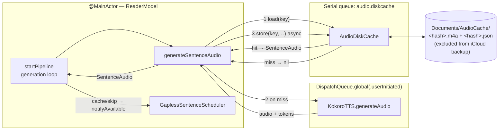
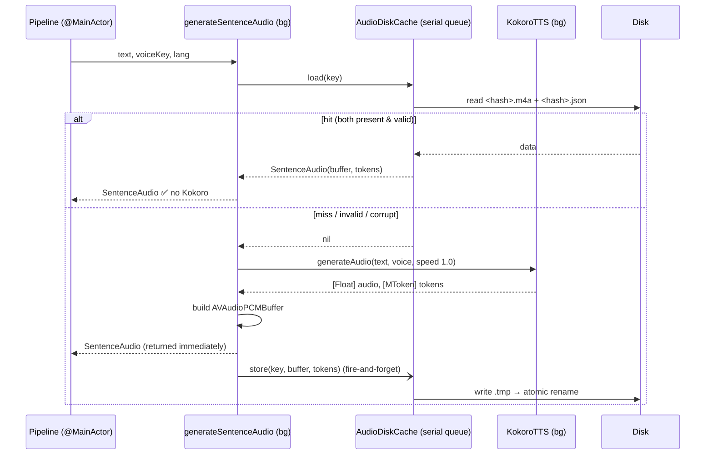
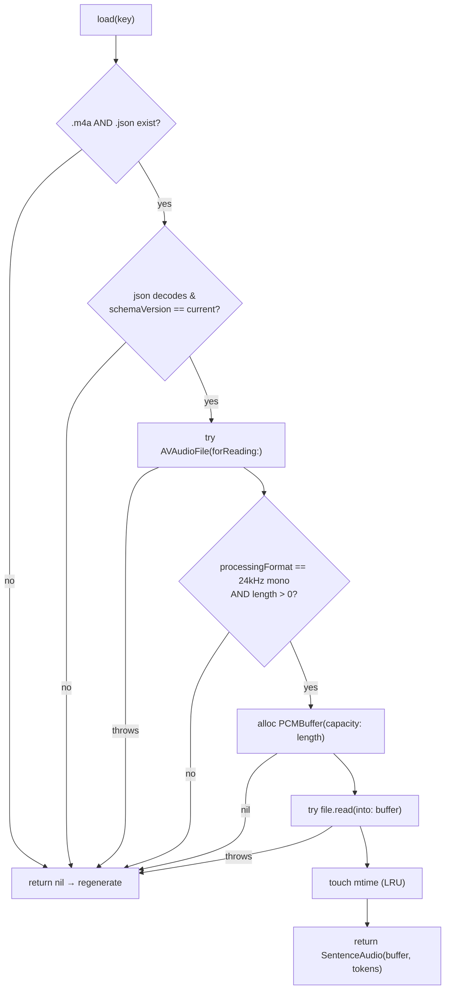
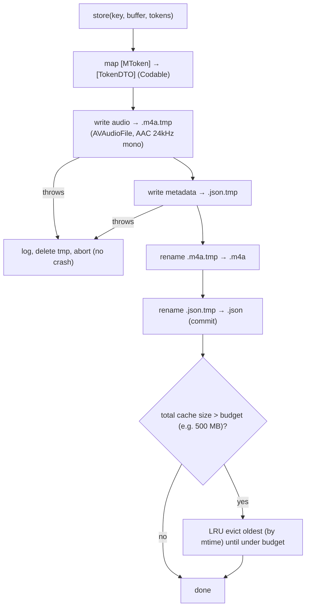

# A1 — On-disk audio cache (design)

**Goal:** persist generated sentence audio so re-reads, skip-back, and offline playback don't
re-run Kokoro. Today `audioCache` is in-memory only and wiped on every play/stop/seek, and
`AudioCacheManager` writes nothing.

**Prime directive (this attempt):** the cache is a pure *optimization*. Every abnormal condition —
missing file, corrupt file, truncated write, format mismatch, decode error, schema change — must
degrade to a **cache miss → regenerate**, never a crash. The previous attempt crashed; this design
is organized around eliminating each crash class (see §5).

---

## 1. Where it sits



All disk I/O is confined to one **serial** queue. Generation stays on the existing background queue;
the main actor never does cache file I/O.

---

## 2. Read / generate path



Key points:
- `load` is consulted **before** Kokoro. A hit skips inference entirely.
- `store` is **fire-and-forget**: playback never waits on disk. If the app dies mid-write, the temp
  file is discarded and the sentence is simply regenerated next time.

---

## 3. `load(key)` — every failure returns `nil` (crash-safe)



No force-unwraps, no `try!`. `.json` is the **commit marker**: audio is renamed into place first,
`.json` last, so a half-written entry (no `.json`) reads as a miss.

---

## 4. `store(key, buffer, tokens)` — atomic write + bounded size



---

## 5. Crash classes from last time → how this design prevents them

| Likely past crash | Root cause | Mitigation here |
|---|---|---|
| Crash decoding audio | Truncated file from app killed mid-write | Atomic temp-write + rename; `.json` written last as commit marker |
| `floatChannelData!` / `AVAudioPCMBuffer(...)!` trap | Force-unwrap on read path | Read via `AVAudioFile.read(into:)`; all allocs guarded, return `nil` on failure |
| Engine crash on schedule | Cached buffer format ≠ engine format | Validate `processingFormat == 24kHz mono` on load; mismatch → miss |
| Crash (re)archiving tokens | `MToken` isn't `NSCoding`/`Codable` | Never persist `MToken`; store a `TokenDTO { text, start, end }` JSON sidecar |
| Data race / EXC_BAD_ACCESS | Concurrent read+write on same file | All cache I/O on one **serial** queue |
| Main-thread hang / watchdog kill | File I/O (or `setActive`) on main | Cache I/O never on main; playback never blocks on `store` |
| Stale audio after model/voice change | Key didn't capture inputs | Key = `SHA256(schemaVersion \| modelTag \| voiceKey \| text)`; bump `schemaVersion` to invalidate all |
| Disk fills up / backup bloat | Unbounded growth in `Documents` (backed up) | 500 MB LRU budget; dir `isExcludedFromBackup = true` |

---

## 6. Keying, storage, format (decisions to confirm)

- **Key:** `SHA256("\(schemaVersion)|\(modelTag)|\(voiceKey)|\(text)")` → hex filename. Speed is
  *not* in the key (generation is always `speed: 1.0`; speed is applied at playback via `timePitch`).
- **Location:** keep `Documents/AudioCache/`, set `isExcludedFromBackup = true` (persists offline,
  survives OS cache purges, doesn't bloat iCloud backup). `AudioCacheManager` already points here —
  its `fileCount()` filter already matches `.m4a` — no change needed.
- **Metadata sidecar (`<hash>.json`):** `{ schemaVersion, sampleRate, originalFrameLength, tokens: [{text,start,end}] }`.
- **Audio format — DECIDED: AAC `.m4a`.** ~6× smaller than PCM (~1 MB/min; 20-min article ≈ 19 MB).
  Written via `AVAudioFile(forWriting:settings:)`:
  ```
  AVFormatIDKey: kAudioFormatMPEG4AAC, AVSampleRateKey: 24000,
  AVNumberOfChannelsKey: 1, AVEncoderBitRateKey: 32000   // 32 kbps mono — ample for speech
  ```
  Read back via `AVAudioFile(forReading:)`, whose `processingFormat` is decoded PCM.
  Convenient: `AudioCacheManager.fileCount()` already filters `.m4a`, so no change there.

### 6.1 The one AAC gotcha — word-highlight timing (not a crash)

AAC round-trips through an encoder that adds **priming (leading) frames** (~2112 samples ≈ 88 ms at
24 kHz) and trailing padding. This does **not** corrupt the tokens — timestamps come from Kokoro on
the *original* PCM and are stored verbatim in the JSON sidecar. The only effect is the decoded audio
can start ~88 ms later than the timestamps assume, so the word highlight can run slightly *ahead* of
the voice on a cache hit (constant, barely perceptible).

Handling (in priority order, ship #1, escalate only if needed):
1. **Store `originalFrameLength` in the sidecar.** On read, if `decodedLength > originalFrameLength`,
   assume the extra head frames are priming and offset `bufferStartTime` by
   `(decodedLength - originalFrameLength) / sampleRate` when this buffer becomes audible, so the
   highlight timer re-aligns. Cheap, no audio edits.
2. If drift is still audible, trim the leading priming frames from the buffer on read.

This is a **correctness** nuance, never a crash — a bad/misaligned decode still falls through §3's
validation to a cache miss.

---

## 7. Integration surface (small, isolated)

- New `AudioDiskCache` type (serial queue, `load`/`store`, LRU, injectable directory). Pure and
  unit-testable (load of missing/corrupt/valid, atomicity, eviction, key stability).
- New `WordTiming` (`Codable`) replaces `MToken` in `SentenceAudio`/`currentTokens`; `MToken` is
  mapped to it once in `generateSentenceAudio`. Keeps the cache MLX-free and serializable.
- `generateSentenceAudio` gains a `load` check first and a `store` after a miss.
- `AudioCacheManager.cacheDirectory` now sets `isExcludedFromBackup`; its size/count/clear UI is
  unchanged (already `.m4a`).
- No change to the scheduler, pipeline shape, or playback path.

---

## 8. Unit-test spec for `AudioDiskCache`

Construct with a temp dir: `AudioDiskCache(maxBytes:, directory: tmp)`. It's off-device testable —
only `AVFoundation` + `Foundation` + `CryptoKit`, no MLX/Kokoro. `store` is async on an internal
serial queue, so tests must drain it before asserting (e.g. round-trip through `load`, which is
`sync` on the same queue and therefore ordered after a prior `store`, or poll for the files).

Helper to build a deterministic PCM buffer (a ramp so trimming/priming is detectable):
```swift
func makeBuffer(frames: AVAudioFrameCount) -> AVAudioPCMBuffer {
    let fmt = AVAudioFormat(standardFormatWithSampleRate: 24000, channels: 1)!
    let b = AVAudioPCMBuffer(pcmFormat: fmt, frameCapacity: frames)!
    b.frameLength = frames
    for i in 0..<Int(frames) { b.floatChannelData![0][i] = Float(i) / Float(frames) }
    return b
}
```

Cases (given / when / then):

1. **Miss on empty cache** — `load(text:"a", voiceKey:"af")` on a fresh temp dir → `nil`.
2. **Round-trip hit** — `store` a buffer+tokens, then `load` → non-nil `SentenceAudio`; `tokens`
   equal what was stored; `buffer.frameLength > 0`. (AAC is lossy, so assert length/known-silence,
   not sample equality.)
3. **Key isolation by text** — `store("a",…)`; `load("b",…)` → `nil`.
4. **Key isolation by voice** — `store(text, "af")`; `load(text, "bf")` → `nil`.
5. **Schema invalidation** — write an entry, then hand-edit its `.json` `schemaVersion` to a
   different value → `load` returns `nil` (and the stale entry is ignored).
6. **Missing commit marker** — after a `store`, delete the `.json` → `load` → `nil` (audio-only is a
   miss). Deleting the `.m4a` and keeping `.json` → also `nil`.
7. **Corrupt audio** — overwrite `.m4a` with random bytes → `load` → `nil`, no throw/crash.
8. **Corrupt metadata** — overwrite `.json` with `"{ not json"` → `load` → `nil`, no crash.
9. **Tokens optional** — `store(tokens: nil)` then `load` → hit with `tokens == nil`.
10. **LRU eviction** — `AudioDiskCache(maxBytes: tiny, directory: tmp)`; store several entries; after
    the budget is exceeded the oldest-by-mtime `.m4a`+`.json` pairs are gone and total ≤ budget.
11. **No partial files after failure** — force a write failure (e.g. read-only dir) → no `.tmp` and
    no half-committed final files remain.
12. **Priming compensation shape** — after a round-trip, either the returned `buffer.frameLength ≈`
    the stored `originalFrameLength` (trimmed) **or** `leadingSilence > 0` (compensated) — never a
    long leading-silence buffer with `leadingSilence == 0`.

---

## 9. Status & on-device verification

**Implemented** (this pass): `WordTiming`, `AudioDiskCache`, backup exclusion, and the
`generateSentenceAudio` load/store wiring. Remaining SourceKit "cannot find type" errors on these
files are the known simulator cascade (no MLX slice) and resolve on a device build.

New files must be added to the **Pagehum target** in Xcode:
`Models/WordTiming.swift`, `Services/AudioDiskCache.swift` (plus the A2 files
`Audio/AudioBufferPlayer.swift`, `Audio/GaplessSentenceScheduler.swift`).

Verify on device:
1. **Cold generate → cache populates** — play a new article; Settings ▸ Storage shows *Audio Files*
   climbing and a non-zero *Cached Audio* size.
2. **Warm replay is instant** — stop, replay the same article/voice; sentences start with no
   "Generating" spinner (cache hits, no Kokoro).
3. **Skip-back is instant** — after A1, already-heard sentences replay without regeneration.
4. **Offline** — enable Airplane Mode, replay a previously-played article → still works.
5. **Voice change re-generates** — switching voice misses the cache (different key) and regenerates.
6. **Highlight stays aligned** on cache hits (priming trim/compensation working).
7. **Gapless preserved** on cache hits (no audible silence between cached sentences).
8. **Clear cache** (Settings) empties the dir; next play regenerates cleanly.
9. **Stability** — background/kill mid-generation, relaunch; no crash, partial entries ignored.
